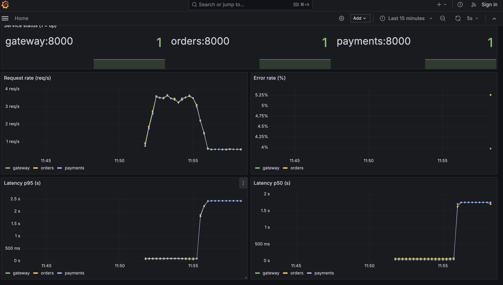
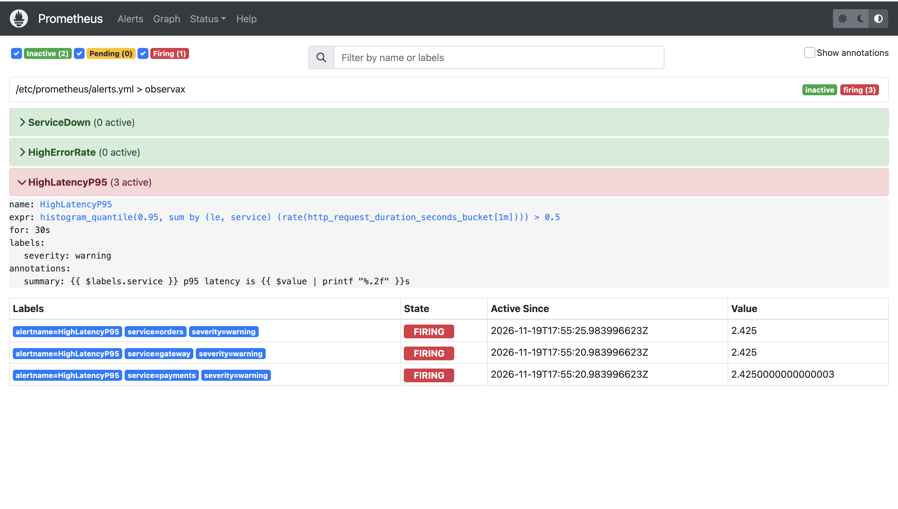
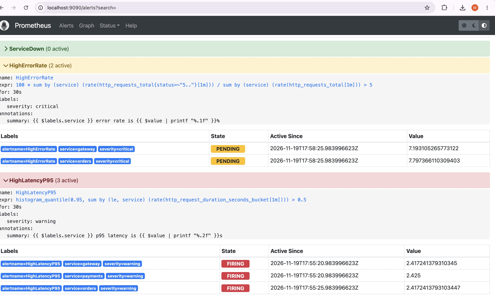
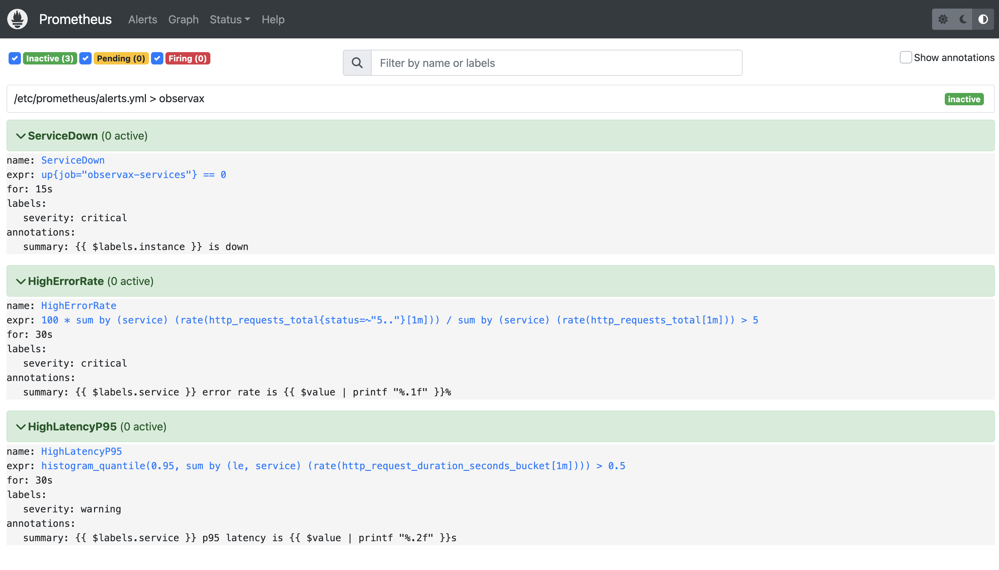

# ObservaX

A small observability platform for multi-service systems. It runs a 3-service demo app (gateway → orders → payments), collects metrics with **Prometheus**, visualizes them in **Grafana**, and fires alerts through **Alertmanager**. Built-in fault injection lets you break services on purpose and watch the monitoring catch it.

## Quick start
```bash
make up            # or: docker compose up -d --build
```
| What | URL |
|---|---|
| Grafana dashboard (no login) | http://localhost:3000 |
| Prometheus | http://localhost:9090 |
| Alertmanager | http://localhost:9093 |
| Gateway | http://localhost:8001/checkout |

A load generator sends ~5 req/s automatically, so the dashboard has data within seconds.

## Demo: break it and watch
```bash
make break-payments   # +1.5s latency in payments
make fail-orders      # 40% of orders requests fail
make heal             # remove all faults
```
1. Run `make break-payments`.
2. In Grafana, p95 latency rises for payments, orders, and gateway (the slowdown propagates upstream).
3. After ~30s, `HighLatencyP95` fires in Prometheus → Alerts and in Alertmanager.
4. Run `make heal` and the alerts resolve.

## What's inside
```
services/      gateway, orders, payments (Flask + prometheus_client)
loadgen/       traffic generator
prometheus/    scrape config + alert rules (ServiceDown, HighErrorRate, HighLatencyP95)
alertmanager/  routing config (Slack example included)
grafana/       auto-provisioned datasource + dashboard
scripts/       chaos.sh fault injection
.github/       CI: lint, validate alert rules and dashboard JSON, build images
docs/          architecture notes
```

## Roadmap
- [ ] Distributed tracing with OpenTelemetry + Tempo/Jaeger
- [ ] Centralized logs with Loki + Promtail
- [ ] SLO dashboards and burn-rate alerts
- [ ] Kubernetes manifests / Helm chart
- [ ] Slack notifications enabled by env var

## What I learned
- Histograms are better than averages for latency, because they show the slow tail (p95) that real users feel.
- When payments slowed down, orders and gateway looked slow too. The symptom shows up at the edge, but the cause is deeper in the chain.
- Slow and broken are different problems: the latency fault raised p95 but not the error rate, so the dashboard tracks both.
- Alert rules use a `for:` delay so one-off blips don't trigger a notification.
- Injecting faults on purpose is a good way to prove that dashboards and alerts work.
## Screenshots

**Latency fault injected into payments: p95 and p50 spike on all three services**


**HighLatencyP95 alert firing in Prometheus**


**Error-rate fault: HighErrorRate pending while the latency alert is already firing**


**Recovery: all alerts return to inactive after the faults are removed**

