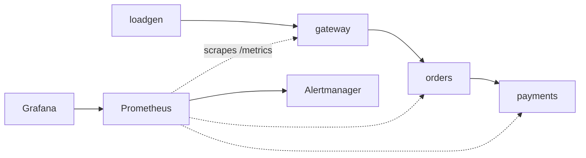

# Architecture

## Metrics exposed by every service
| Metric | Type | Labels |
|---|---|---|
| `http_requests_total` | counter | service, method, endpoint, status |
| `http_request_duration_seconds` | histogram | service, endpoint |

## Design decisions
- **One shared metric contract**: every service exports identical metric names, so one dashboard and one set of alert rules cover all services.
- **Built-in chaos endpoint** (`/chaos`): makes failures reproducible for demos and for testing alerts.
- **Provisioned Grafana**: datasource and dashboard load from files, so `docker compose up` gives a working setup with no clicking.
